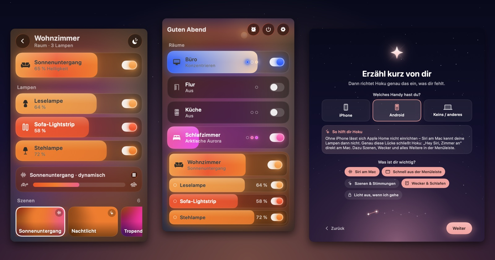
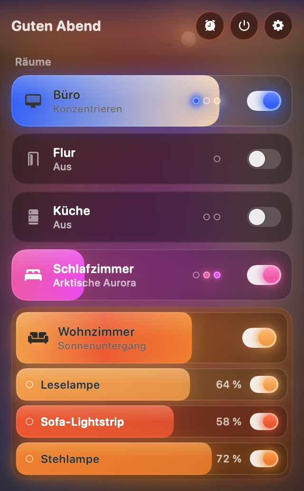
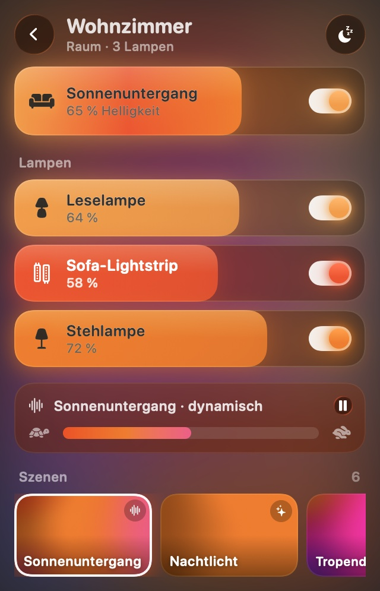
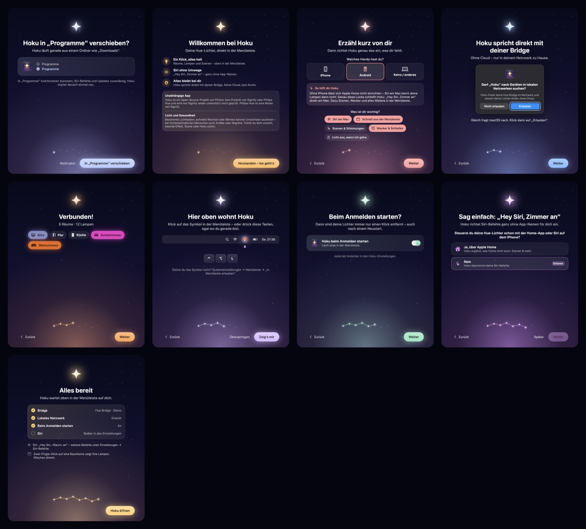

<p align="center"></p>
<h1 align="center">Hoku</h1>

<p align="center"><strong>Deine Philips-Hue-Lichter direkt in der Mac-Menüleiste – mit Siri, ganz ohne iPhone.</strong></p>
<p align="center"><sub>Native macOS-App · lokal, ohne Cloud und ohne Konto · kostenlos und Open Source</sub></p>

<p align="center">
  <a href="https://github.com/Philoni/hoku/releases/latest"></a>
  <a href="https://github.com/Philoni/hoku/releases"></a>
  
  
  <a href="LICENSE"></a>
  <a href="https://github.com/Philoni/hoku/actions/workflows/ci.yml"></a>
</p>

<p align="center">
  <a href="https://github.com/Philoni/hoku/releases/latest"><strong>Download</strong></a> ·
  <a href="https://philoni.github.io/hoku/">Webseite</a> ·
  <a href="docs/help/">Hilfe</a> ·
  <a href="docs/help/faq.md">Häufige Fragen</a> ·
  <a href="README.md">English</a>
</p>

<p align="center"></p>
<p align="center"><em>Die Screenshots zeigen die deutsche Oberfläche. Die App folgt deiner Systemsprache, Deutsch oder Englisch.</em></p>

---

## Warum Hoku

Du hast einen Mac und Philips Hue, aber Siri am Mac weiß nichts von deinen Lampen. Das liegt an Apple Home: Lampen lassen sich dort nur mit einem iPhone oder iPad hinzufügen.

Hoku schließt diese Lücke. Es spricht direkt mit deiner Hue Bridge, legt alle Räume, Lampen und Szenen in die Menüleiste und richtet Siri-Befehle ein, die am Mac selbst funktionieren. Vieles geht außerdem schneller als in einer Handy-App.

## Was Hoku kann

- **Ein Klick, alles hell:** Räume und Zonen als leuchtende Karten. Ziehen dimmt, ein Schalter schaltet, ein **Zwei-Finger-Klick klappt die Lampen eines Raums auf**.
- **Siri ohne App-Namen:** „Hey Siri, Zimmer an“, „Vitrine aus“, „Alles aus“. Hoku legt dafür persönliche Kurzbefehle an – auch Schreibweisen wie „Light Strip“ und Einzahl/Mehrzahl werden verstanden.
- **Hue-Szenen:** mit Vorschau beim Darüberfahren, dynamische Szenen mit Tempo-Regler, Lieblingsszenen zuerst.
- **Wecker und Schlafen:** Lichtwecker mit Sonnenaufgang (inkl. Vorschau im Zeitraffer), „Schlafen gehen“ und Einschlaf-Timer – läuft auf der Bridge, auch wenn der Mac schläft.
- **Licht aus, wenn du gehst:** beim Sperren oder Zuklappen des Macs – und wieder an, wenn du zurückkommst.
- **Tastenkürzel fürs Licht:** Räume und Zonen schalten, Szenen starten oder alles ausschalten, per eigener Tastenkombination und überall am Mac. Eine kleine Kapsel unter dem Menüleistensymbol bestätigt, was passiert ist.
- **Tastatur und Gesten:** ⌃⌥L öffnet Hoku von überall, Pfeiltasten steuern, Wischen dimmt.
- **Anordnen und anheften:** Räume und Zonen oben anheften und in eigener Reihenfolge sortieren.
- **Verbindungsdetails:** koppeln per Link-Knopf, mit einem vorhandenen Anwendungsschlüssel, Verbindungsdetails ansehen oder die Bridge-Adresse von Hand setzen.
- **Sync-Erkennung:** Steuert Hue Sync oder eine andere Sync-App einen Entertainment-Bereich, sagt Hoku das auf der Startseite und bietet an, es zu beenden.
- **VoiceOver:** Karten, Schalter, Regler, Farbrad, Szenen und Tastenkürzel sind beschriftet und bedienbar.
- **Deutsch und Englisch:** App, Hinweise, Einrichtung und Siri-Befehle folgen der Systemsprache.
- **Geräte-Check:** leere Batterien, nicht erreichbare Lampen, anstehende Updates.
- **Lernt mit:** schlägt zur passenden Tageszeit die Szene vor, die du dann oft nutzt. Berechnet und gespeichert nur auf deinem Mac.
- **Leicht für deinen Mac:** bei geschlossenem Fenster 0 % CPU.

| Übersicht | Raum | Einrichtung |
|---|---|---|
|  |  |  |

## Für wen ist Hoku?

Hoku fragt bei der Einrichtung nach deiner Ausstattung und richtet genau das ein, was dir fehlt.

| Deine Ausstattung | Was dir ohne Hoku fehlt | Was Hoku dir gibt |
|---|---|---|
| **Mac + Android-Handy** (oder gar kein Handy) | Kein Apple Home möglich → Siri am Mac kennt deine Lampen nicht, am Mac gibt es keine Hue-Steuerung | **„Hey Siri, Wohnzimmer an“ direkt am Mac**, alle Räume, Lampen und Szenen in der Menüleiste |
| **Mac + iPhone, Hue nicht in Apple Home** | Siri am Mac kennt deine Lampen nicht, bis du Apple Home einrichtest | Siri-Befehle sofort, ohne Apple Home – oder Hoku erklärt dir den Weg dorthin |
| **Mac + iPhone mit Apple Home** | Home kann an/aus und Helligkeit, aber keine echten Hue-Szenen, keine dynamischen Szenen, keine Hue-Routinen | Hue-Szenen inkl. dynamisch und Tempo, **Wecker mit Sonnenaufgang**, Einschlaf-Timer, Geräte-Check – blitzschnell in der Menüleiste |
| **Mehrere Personen / Macs im Haushalt** | Nur das Handy der Person, die Hue eingerichtet hat, „kennt“ alles | Jeder Mac koppelt sich selbst, mit eigenen Siri-Befehlen und eigenen Lieblingsszenen |
| **Du hast Hue Sync ausprobiert** | Hue Sync lässt Licht zu Filmen, Spielen und Musik am Computer tanzen – Räume, einzelne Lampen oder Szenen fürs Zuhause steuert es nicht | **Jeder Raum, jede Lampe, jede Szene** in der Menüleiste. Hue Sync kannst du für Effekte trotzdem weiter nutzen |
| **Datenschutz ist dir wichtig** | Viele Apps brauchen ein Konto oder die Hue-Cloud | Hoku spricht **nur mit deiner Bridge im Heimnetz**. Kein Konto, keine Telemetrie |

### Hoku oder Hue Sync?

Beides, je nach Aufgabe: Hue Sync lässt dein Licht zum Bildschirm tanzen. Hoku ist dein Lichtschalter am Mac.

## Installation

**Voraussetzungen:** macOS 26 (Tahoe) oder neuer. Eine Hue Bridge v2 (eckig) oder Bridge Pro im **selben Netzwerk** wie dein Mac. Für eigene Siri-Befehle: Mit deinem Apple Account (iCloud) am Mac angemeldet.

### Download

1. Lade das **DMG** `Hoku-X.Y.Z.dmg` von den [Releases](https://github.com/Philoni/hoku/releases/latest) und öffne es.
2. **Zieh Hoku in den Ordner Programme.** Wirf das Disk-Image danach aus – mehrere Kopien verwirren Siri.
3. Öffne Hoku. macOS meldet, dass Apple die App nicht prüfen konnte → **Fertig**.
4. **Systemeinstellungen → Datenschutz & Sicherheit** → ganz unten bei „Hoku“ auf **Dennoch öffnen** klicken und bestätigen.

Das ist **nur einmal** nötig. Warum? Hoku ist kostenlos; Apples Notarisierung kostet 99 € im Jahr. Hoku ist deshalb mit einem eigenen, dauerhaften Zertifikat signiert, aber nicht von Apple notarisiert.
Ausführlich mit Bildern: [Installieren](docs/help/installieren.md).

### Homebrew

```bash
brew tap philoni/hoku
brew trust philoni/hoku
brew install --cask hoku
```

Später aktualisierst du mit `brew upgrade --cask hoku`.

### Selbst bauen

Mit Xcode 27 und einer kostenlosen Apple-ID (Xcode → Einstellungen → Accounts → Personal Team → Zertifikat „Apple Development“):

```sh
brew install xcodegen
git clone https://github.com/Philoni/hoku.git && cd hoku
make install    # baut, installiert nach ~/Applications und startet Hoku
```

`make test` startet die Tests. Den Aufbau des Codes erklärt [docs/ARCHITECTURE.md](docs/ARCHITECTURE.md).

## Erster Start

Ein kurzer Assistent führt dich durch alles: deine Ausstattung, die Netzwerk-Erlaubnis (erst erklärt, dann gefragt), das Koppeln mit der Bridge (einmal auf den runden Knopf drücken), Autostart und Siri.
Später erreichst du ihn unter **Einstellungen → Einrichtung erneut starten**.

## Hilfe

Die Hilfeseiten sind zweisprachig (Deutsch und Englisch).

- [Installieren](docs/help/installieren.md) · [Siri einrichten](docs/help/siri.md) · [Gesten & Tastatur](docs/help/gesten-und-tastatur.md)
- [Fehlerbehebung](docs/help/fehlerbehebung.md) · [Häufige Fragen](docs/help/faq.md) · [Datenschutz](docs/help/datenschutz.md)
- Fehler gefunden oder eine Idee? → [Issue anlegen](https://github.com/Philoni/hoku/issues/new/choose)

## Datenschutz

Hoku spricht **direkt mit deiner Hue Bridge in deinem Netzwerk** – ohne Cloud, ohne Konto, ohne Telemetrie. Der Bridge-Schlüssel liegt nur auf deinem Mac.
Ins Internet geht nur: die Bridge-Suche bei Signify (`discovery.meethue.com`), falls die Bridge im Netzwerk nicht von selbst auftaucht, und das Signieren deiner Siri-Kurzbefehle durch macOS über iCloud. Details: [Datenschutz](docs/help/datenschutz.md).

## Hinweise

> **Hoku ist keine App von Signify.** Hoku ist ein unabhängiges Open-Source-Projekt von Philoni und keine App, kein Produkt und kein Dienst von Signify (Philips Hue). Signify stellt Hoku weder her noch unterstützt oder prüft es; verantwortlich ist allein Philoni. Philips und Philips Hue sind Marken ihrer jeweiligen Inhaber.

> **Licht und Gesundheit:** Bestimmte Lichtfarben, schnelle Wechsel oder Blinken können Unwohlsein auslösen – bei lichtempfindlichen Menschen (z. B. mit fotosensitiver Epilepsie) auch Anfälle oder Migräne. Fühlst du dich unwohl, beende Effekt, Szene oder Hoku sofort.

## Status und Ausblick

Hoku ist eine **Beta**. Die App gibt es auf Deutsch und Englisch, je nach Systemsprache (ab 0.9.1); automatische Updates sind geplant. Was als Nächstes kommt, steht im [CHANGELOG](CHANGELOG.md).

## Mitmachen und Lizenz

Beiträge sind willkommen – siehe [CONTRIBUTING.md](CONTRIBUTING.md). Hoku steht unter der [MIT-Lizenz](LICENSE); verwendete Fremdarbeit steht in [THIRD_PARTY_NOTICES.md](THIRD_PARTY_NOTICES.md).
