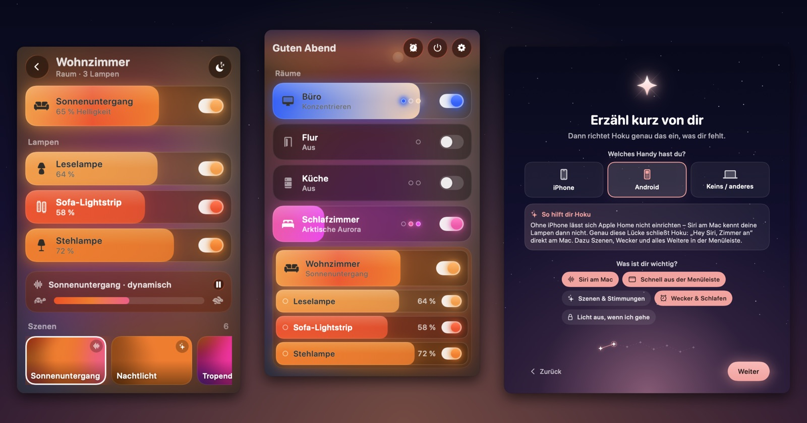
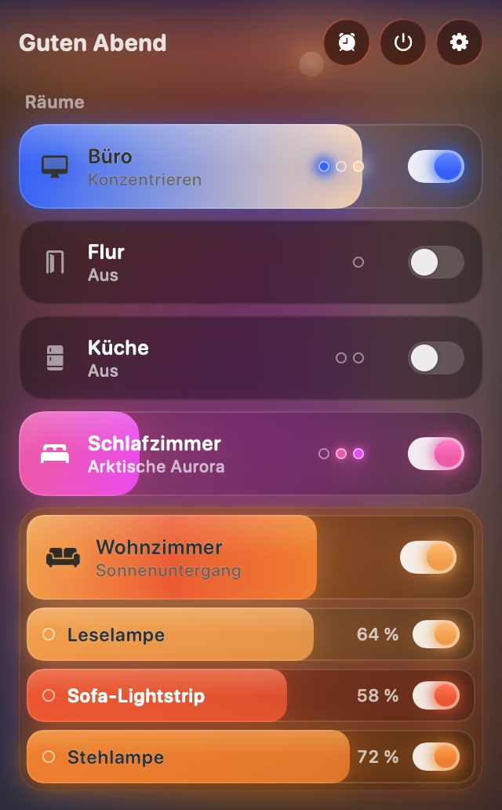
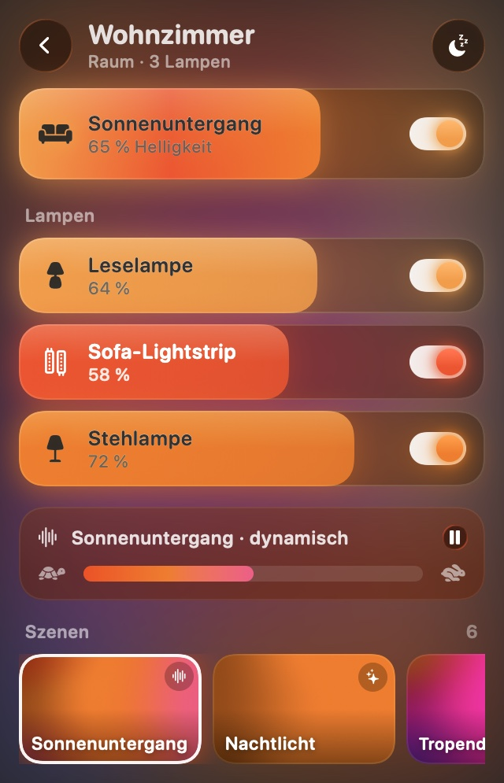
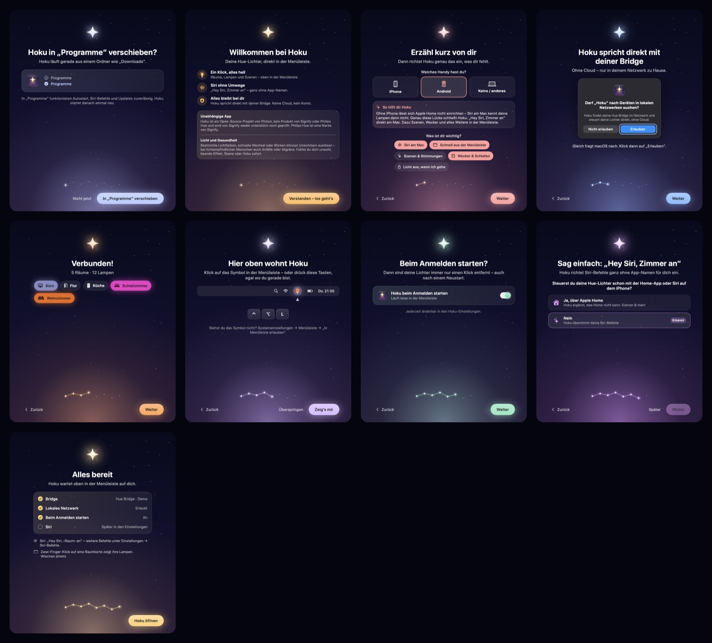

# Hoku

**Deine Philips-Hue-Lichter, direkt in der Mac-Menüleiste – mit Siri, ganz ohne iPhone.**
Native macOS-App · lokal, ohne Cloud und ohne Konto · kostenlos und Open Source.



> **English summary [below](#english).**

---

## Für wen ist Hoku?

Du hast einen **Mac** und **Philips Hue** – aber Siri am Mac weiß nichts von deinen Lampen?
Das liegt an Apple Home: Lampen lassen sich dort nur mit einem iPhone oder iPad hinzufügen.
Hoku schließt diese Lücke und macht nebenbei vieles schneller als jede Handy-App.

| Deine Ausstattung | Was dir ohne Hoku fehlt | Was Hoku dir gibt |
|---|---|---|
| **Mac + Android-Handy** (oder gar kein Handy) | Kein Apple Home möglich → Siri am Mac kennt deine Lampen nicht, am Mac gibt es keine Hue-Steuerung | **„Hey Siri, Wohnzimmer an“ direkt am Mac**, alle Räume, Lampen und Szenen in der Menüleiste |
| **Mac + iPhone, Hue nicht in Apple Home** | Siri am Mac kennt deine Lampen nicht, bis du Apple Home einrichtest | Siri-Befehle sofort, ohne Apple Home – oder Hoku erklärt dir den Weg dorthin |
| **Mac + iPhone mit Apple Home** | Home kann an/aus und Helligkeit, aber keine echten Hue-Szenen, keine dynamischen Szenen, keine Hue-Routinen | Hue-Szenen inkl. dynamisch und Tempo, **Wecker mit Sonnenaufgang**, Einschlaf-Timer, Geräte-Check – blitzschnell in der Menüleiste |
| **Mehrere Personen / Macs im Haushalt** | Nur das Handy der Person, die Hue eingerichtet hat, „kennt“ alles | Jeder Mac koppelt sich selbst, mit eigenen Siri-Befehlen und eigenen Lieblingsszenen |
| **Du hast Hue Sync ausprobiert** | Hue Sync lässt Licht zu Filmen, Spielen und Musik am Computer tanzen – Räume, einzelne Lampen oder Szenen fürs Zuhause steuert es nicht | **Jeder Raum, jede Lampe, jede Szene** in der Menüleiste. Hue Sync kannst du für Effekte trotzdem weiter nutzen |
| **Datenschutz ist dir wichtig** | Viele Apps brauchen ein Konto oder die Hue-Cloud | Hoku spricht **nur mit deiner Bridge im Heimnetz**. Kein Konto, keine Telemetrie |

Hoku fragt bei der Einrichtung nach deiner Ausstattung und richtet genau das ein, was dir fehlt.

**Hoku oder Hue Sync?** Beides, je nach Aufgabe: Hue Sync lässt dein Licht zum Bildschirm tanzen. Hoku ist dein Lichtschalter am Mac.

## Was Hoku kann

- **Ein Klick, alles hell:** Räume und Zonen als leuchtende Karten. Ziehen dimmt, ein Schalter schaltet, ein **Zwei-Finger-Klick klappt die Lampen eines Raums auf**.
- **Siri ohne App-Namen:** „Hey Siri, Zimmer an“, „Vitrine aus“, „Alles aus“. Hoku legt dafür persönliche Kurzbefehle an – auch Schreibweisen wie „Light Strip“ und Einzahl/Mehrzahl werden verstanden.
- **Hue-Szenen:** mit Vorschau beim Darüberfahren, dynamische Szenen mit Tempo-Regler, Lieblingsszenen zuerst.
- **Wecker & Schlafen:** Lichtwecker mit Sonnenaufgang (inkl. Vorschau im Zeitraffer), „Schlafen gehen“ und Einschlaf-Timer – läuft auf der Bridge, auch wenn der Mac schläft.
- **Licht aus, wenn du gehst:** beim Sperren oder Zuklappen des Macs – und wieder an, wenn du zurückkommst.
- **Tastatur & Gesten:** ⌃⌥L öffnet Hoku von überall, Pfeiltasten steuern, Wischen dimmt.
- **Geräte-Check:** leere Batterien, nicht erreichbare Lampen, anstehende Updates.
- **Lernt mit:** schlägt zur passenden Tageszeit die Szene vor, die du dann oft nutzt.
- **Leicht für deinen Mac:** bei geschlossenem Fenster 0 % CPU.

| Übersicht | Raum | Einrichtung |
|---|---|---|
|  |  |  |

## Voraussetzungen

- macOS 26 (Tahoe) oder neuer
- Philips Hue Bridge (v2 oder Pro) im **selben Netzwerk** wie dein Mac
- Für eigene Siri-Befehle: Mit deinem Apple Account (iCloud) am Mac angemeldet

## Installation

### Fertige App
1. Lade **`Hoku-X.Y.Z.zip`** von den [Releases](https://github.com/Philoni/hoku/releases/latest) und öffne die Zip-Datei.
2. **Zieh `Hoku.app` in den Ordner Programme.** Lösch danach die Zip-Datei – mehrere Kopien verwirren Siri.
3. Öffne Hoku. macOS meldet, dass Apple die App nicht prüfen konnte → **Fertig**.
4. **Systemeinstellungen → Datenschutz & Sicherheit** → ganz unten bei „Hoku“ auf **Dennoch öffnen** klicken und bestätigen.

Das ist **nur einmal** nötig. Warum? Hoku ist kostenlos; Apples Notarisierung kostet 99 € im Jahr. Hoku ist deshalb mit einem eigenen, dauerhaften Zertifikat signiert, aber nicht von Apple notarisiert.
Ausführlich mit Bildern: [Installieren](docs/help/installieren.md).

### Selbst bauen
Mit Xcode 27 und einer kostenlosen Apple-ID (Xcode → Einstellungen → Accounts → Personal Team → Zertifikat „Apple Development“):

```sh
brew install xcodegen
git clone https://github.com/Philoni/hoku.git && cd hoku
make install    # baut, installiert nach ~/Applications und startet Hoku
```

`make test` startet die Tests. Den Aufbau des Codes erklärt [docs/ARCHITECTURE.md](docs/ARCHITECTURE.md).

## Erster Start

Ein kurzer Assistent führt dich durch alles: deine Ausstattung, die Netzwerk-Erlaubnis (erst erklärt, dann gefragt), das Koppeln mit der Bridge (einmal auf den runden Knopf drücken), Autostart und Siri.
Später erreichst du ihn unter **Einstellungen → Einrichtung erneut starten**.

## Hilfe

- [Installieren](docs/help/installieren.md) · [Siri einrichten](docs/help/siri.md) · [Gesten & Tastatur](docs/help/gesten-und-tastatur.md)
- [Fehlerbehebung](docs/help/fehlerbehebung.md) · [Häufige Fragen](docs/help/faq.md) · [Datenschutz](docs/help/datenschutz.md)
- Fehler gefunden oder eine Idee? → [Issue anlegen](https://github.com/Philoni/hoku/issues/new/choose)

## Datenschutz

Hoku spricht **direkt mit deiner Hue Bridge in deinem Netzwerk** – ohne Cloud, ohne Konto, ohne Telemetrie. Der Bridge-Schlüssel liegt nur auf deinem Mac.
Ins Internet geht nur: die Bridge-Suche bei Signify (`discovery.meethue.com`), falls die Bridge im Netzwerk nicht von selbst auftaucht, und das Signieren deiner Siri-Kurzbefehle durch macOS über iCloud. Details: [Datenschutz](docs/help/datenschutz.md).

## Hinweise

> **Hoku ist keine App von Signify.** Hoku ist ein unabhängiges Open-Source-Projekt von Philoni und keine App, kein Produkt und kein Dienst von Signify (Philips Hue). Signify stellt Hoku weder her noch unterstützt oder prüft es; verantwortlich ist allein Philoni. Philips und Philips Hue sind Marken ihrer jeweiligen Inhaber.

> **Licht und Gesundheit:** Bestimmte Lichtfarben, schnelle Wechsel oder Blinken können Unwohlsein auslösen – bei lichtempfindlichen Menschen (z. B. mit fotosensitiver Epilepsie) auch Anfälle oder Migräne. Fühlst du dich unwohl, beende Effekt, Szene oder Hoku sofort.

## Status

Hoku ist eine **Beta**. Die App ist derzeit auf Deutsch; Englisch und automatische Updates folgen. Was als Nächstes kommt, steht im [CHANGELOG](CHANGELOG.md).

## Mitmachen & Lizenz

Beiträge sind willkommen – siehe [CONTRIBUTING.md](CONTRIBUTING.md). Hoku steht unter der [MIT-Lizenz](LICENSE); verwendete Fremdarbeit steht in [THIRD_PARTY_NOTICES.md](THIRD_PARTY_NOTICES.md).

---

## English

**Hoku** puts your Philips Hue lights into the Mac menu bar – with Siri, no iPhone required. Native, local-only (no cloud, no account, no telemetry), free and open source.

**Who is it for?**
- **Mac + Android (or no phone):** Apple Home needs an iPhone or iPad to add lights, so Siri on your Mac knows nothing about them. Hoku fixes that: “Hey Siri, living room on” right on your Mac, plus all rooms, lamps and scenes in the menu bar.
- **Mac + iPhone, Hue not in Apple Home:** Siri commands right away – or Hoku shows you how to add your bridge to Home.
- **Apple Home users:** Home does on/off and brightness; Hoku adds real Hue scenes (including dynamic ones), a sunrise wake-up light, sleep timer and device check – instantly from the menu bar.
- **Households:** every Mac pairs on its own, with its own Siri commands and favourites.
- **Tried Hue Sync?** It makes your lights dance to films, games and music on your computer, but doesn’t control rooms, single lamps or everyday scenes. Hoku does – and you can keep Hue Sync for the effects.

**Highlights:** two-finger click unfolds a room's lamps · Siri without the app name (personal shortcuts Hoku creates for you) · scene preview on hover · wake-up light and go-to-sleep routines that run on the bridge · lights off when you lock your Mac · ⌃⌥L from anywhere · 0 % CPU when closed.

**Requirements:** macOS 26 or later, a Hue Bridge (v2/Pro) on the same network.

**Install:** download `Hoku-X.Y.Z.zip` from [Releases](https://github.com/Philoni/hoku/releases/latest), drag `Hoku.app` to Applications, open it, then **System Settings → Privacy & Security → Open Anyway** (once). Hoku is signed with its own long-lived certificate but not notarized (Apple's program costs $99/year).
**Build from source:** Xcode 27 + a free Apple ID, then `brew install xcodegen && make install`.

**Status:** beta, currently in German; English and automatic updates are coming.

> Hoku is provided by Philoni. It is not a Signify app, product or service, is not endorsed by Signify, and Philoni alone is responsible for it. Philips and Philips Hue are trademarks of their respective owners.
> **Health notice:** certain light colours, fast changes or flashing can cause discomfort and, for people with photosensitive epilepsy, seizures or migraines. Stop the effect, scene or app if you feel unwell.

MIT License · see [LICENSE](LICENSE) and [THIRD_PARTY_NOTICES.md](THIRD_PARTY_NOTICES.md).
